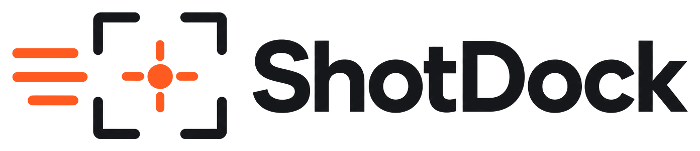

<p align="center">
  <picture>
    <source media="(prefers-color-scheme: dark)" srcset="design/logo-blanco.png">
    
  </picture>
</p>

# ShotDock

App para macOS para hacer y gestionar capturas de pantalla, con todo lo que hace Shottr.

## Qué hace

- **Capturas**: área (sobre la pantalla congelada, con lupa), ventana (elegirla o la activa),
  pantalla completa, repetir la última área, con retardo y con scroll.
- **Editor**: flecha, rectángulo, óvalo, texto, resaltador, pasos numerados, desenfocar,
  pixelar, borrador inteligente (rellena con el fondo, también degradados), recortar,
  tiradores para redimensionar, deshacer.
- **Medir**: regla de píxeles entre bordes, lupa y cuentagotas (HEX/RGB), también global.
- **OCR y QR** con Vision: el atajo copia el texto (o el contenido del QR) del área.
- **Fijar** capturas encima de todo, con zoom, opacidad y clics que la atraviesan.
- **Fondos y marcos** para compartir: degradados, margen, esquinas, sombra y proporción.
- **Subida a S3** (AWS, Cloudflare R2, Backblaze B2, MinIO…) con el enlace copiado;
  claves en el llavero.
- **El dock**: historial de capturas con sus anotaciones editables, galería para reabrir,
  copiar, guardar, subir, fijar o arrastrar a otra app.
- **Redimensionar** y **ocultar secretos** (claves de API, tokens, contraseñas, correos,
  tarjetas, IBAN) con cajas negras, desde el menú Imagen del editor.
- **CLI y servidor MCP** para agentes de IA (Claude Code, Codex, Cursor…) con todo lo
  anterior: ver más abajo.
- Barra de menús, atajos globales configurables (se importan los de Shottr), preferencias,
  nombre y carpeta de guardado configurables, abrir al iniciar sesión.

## Requisitos

- macOS 15 o posterior, Xcode 16+ (probado con Xcode 27.2 en macOS 27).

## Compilar y ejecutar

```sh
make signing-cert     # una vez por Mac: identidad local "ShotDock Local Signing"
make test             # tests de ShotDockCore
make run              # monta build/ShotDock.app, la firma y la abre
make install          # versión release en /Applications
make selftest TEST=…  # pruebas en la app real: capture, area, editor, modes, prefs, measure,
                      # history, pin-ocr, backdrop, scroll, dock, branding
make selftest-upload  # subida contra un S3 local (scripts/mock-s3.py)
make selftest-cli     # la CLI y el MCP con el binario real: cli, mcp, cli-history, cli-edit,
                      # cli-inspect, cli-share, cli-prefs, cli-redact, cli-capture
```

La firma local estable hace que macOS conserve el permiso de Grabación de
pantalla entre compilaciones. La primera vez hay que concederlo en
Ajustes del Sistema › Privacidad y seguridad › Grabación de pantalla. La captura
con scroll automática necesita además el permiso de Accesibilidad.

Las pruebas `selftest` manejan la app con eventos simulados, usan unas preferencias,
un historial y un llavero propios, y no tocan los del usuario.

## CLI y MCP para agentes

`shotdock` es la herramienta de línea de órdenes de ShotDock, y `shotdock mcp` su servidor
MCP. Todo lo que hace la interfaz se puede hacer desde ahí: capturar, anotar, recortar,
redimensionar, poner fondo, medir, leer texto y códigos QR, ocultar secretos, fijar, subir,
gestionar el historial y cambiar las preferencias y los atajos.

**Cómo funciona.** El binario va dentro de la app (`ShotDock.app/Contents/Helpers/shotdock`)
y habla con ella por un socket local (`~/Library/Application Support/ShotDock/control.sock`,
solo para tu usuario). Captura la app, con su propio permiso de Grabación de pantalla: no hace
falta dárselo a la terminal ni al agente. Si la app no está abierta, `shotdock` la abre en
segundo plano. La app es también la única que escribe en el historial, así que lo que hace un
agente aparece en la galería y, si la captura está abierta en el editor, se ve al momento y
se puede deshacer.

**Activarlo.** Viene desactivado. Actívalo en Preferencias › Agentes. La primera vez que un
agente lo use, ShotDock pregunta («¿Permitir que «claude en Terminal» controle ShotDock?»).
Los agentes permitidos aparecen en esa pestaña, donde se les puede retirar el permiso.
`make install` (o el botón de esa pestaña) enlaza `shotdock` en `/usr/local/bin` o en
`~/.local/bin`.

**Registrar el MCP.**

```sh
claude mcp add shotdock -- shotdock mcp          # Claude Code
```

Codex (`~/.codex/config.toml`):

```toml
[mcp_servers.shotdock]
command = "shotdock"
args = ["mcp"]
```

Cursor (`~/.cursor/mcp.json`): `{"mcpServers": {"shotdock": {"command": "shotdock", "args": ["mcp"]}}}`

Cada orden de la CLI es una herramienta MCP (`capture_area`, `annotate`, `recognize_text`,
`history_list`…). Las capturas vuelven como imagen para el modelo (como mucho 1568 px) y
como ruta al PNG a resolución completa, con `preview_scale` para pasar coordenadas de la vista
previa a píxeles. Las claves de S3 son lo único que no está en el MCP, para que un secreto
nunca pase por el modelo.

**Ejemplos.**

```sh
shotdock windows --app safari                       # ventanas, de delante a atrás
shotdock capture window --app safari --json         # id, path, width, height, scale…
shotdock capture area --rect 0,0,800,600 --redact   # en puntos; tapa los secretos
shotdock capture screen --display 2 --out ~/Desktop/pantalla.png
shotdock annotate arrow last --from 100,80 --to 320,200 --color blue
shotdock annotate highlight last --on-text "Guardar"   # sobre el texto, por OCR
shotdock annotate last --annotations @marcas.json   # varias de una vez
shotdock crop last --rect 0,0,1200,800 && shotdock resize last --scale 0.5
shotdock backdrop last --preset 3 --padding 32
shotdock ocr last --json                            # texto, líneas y QR con cajas
shotdock measure last --at 210,140                  # regla entre bordes
shotdock upload last --copy                         # enlace de S3
shotdock history list --search factura --since 2d
shotdock prefs set image_format jpeg
shotdock shortcuts set capture_window "shift+cmd+4"
shotdock help capture area                          # opciones de cada orden
shotdock schema                                     # todas, en JSON
```

- **Coordenadas.** Los rectángulos de pantalla van en puntos, globales, con el origen arriba
  a la izquierda de la pantalla principal (como `screencapture -R` y `shotdock windows`). Las
  posiciones sobre una imagen van en píxeles de la imagen tal como está editada (con recorte,
  fondo y redimensionado), que es la que devuelven `path` y la vista previa.
- **Capturas silenciosas.** Lo que captura un agente va al historial y a un fichero, sin tocar
  el portapapeles, abrir el editor ni quitar el foco, salvo que lo pida con `--copy`, `--save`,
  `--upload`, `--edit` o `--pin`.
- **Capturas** se nombran por id (o su principio), `last`, `last-1`…, o por la ruta de una
  imagen, que se añade al historial.
- **`--json`** en todas las órdenes. Códigos de salida: 0 bien, 1 la orden falló (`error.kind`:
  `not_found`, `not_authorized`, `permission_denied`, `cancelled`…), 2 uso incorrecto,
  3 ShotDock no está disponible.

## Estructura

- `Sources/ShotDockCore`: lógica sin interfaz (anotaciones y su dibujo, efectos, borrador
  inteligente, regla, OCR, unión de capturas con scroll, fondos, historial, firma S3,
  importación de Shottr, secretos), con tests. En `Remote/`, el catálogo de órdenes del que
  salen la CLI, el MCP y el despacho de la app, JSON-RPC, el socket y el servidor MCP.
- `Sources/ShotDockCLI`: el binario `shotdock` (CLI y `shotdock mcp`).
- `Sources/ShotDock`: la app de barra de menús (AppKit + SwiftUI, ScreenCaptureKit, Vision);
  en `Remote/`, lo que responde a la CLI.
- `Resources/Info.plist`: plist del bundle (`app.shotdock.ShotDock`).
- `Resources/Assets.xcassets`: AppIcon, icono de la barra de menús, logo y color de acento (#FF5A1F).
- `design/`: diseño aprobado (`icono.png`, `logo.png`) y sus fuentes vectoriales. `make icons`
  regenera los iconos desde `design/make-icons.swift`; `swift design/make-logo.swift` las
  versiones del logo con fondo transparente y en blanco.
